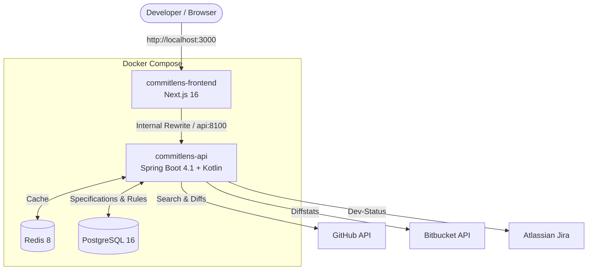

# CommitLens

CommitLens is a lightweight, self-hosted analytics engine that turns raw Git commit history from GitHub and Bitbucket into actionable insights. It parses every commit against the [Conventional Commits](https://www.conventionalcommits.org/) specification or custom team-defined specifications, and traces Jira issues back to the code that implemented them.



---

## Architecture & Tech Stack

| Layer    | Technology                                                                          |
|----------|-------------------------------------------------------------------------------------|
| Frontend | Next.js 16 (App Router, Standalone Build), Tailwind CSS, Lucide Icons, Recharts    |
| Backend  | Kotlin 2.3, Spring Boot 4.1, Spring Data JPA / Hibernate, Spring Data Redis, Log4j2 |
| Database | PostgreSQL 16 (Persistent rule specifications), H2 (In-memory test database)        |
| Cache    | Redis 8+ (Client-level caching with CustomKeyGenerator)                             |
| API Docs | springdoc-openapi (OpenAPI 3 / Swagger UI)                                         |

```
commit-lens/
├── commitlens-api/        # Spring Boot + Kotlin REST API (port 8100)
├── commitlens-frontend/   # Next.js dashboard with collapsible sidebar (port 3000)
├── docker/                # Modular development Docker Compose setup
│   ├── compose.yaml       # Root dev compose referencing sub-stacks
│   ├── .env.example       # Development environment template
│   ├── infra/             # Redis & PostgreSQL compose definition
│   ├── api/               # Backend container definition
│   └── frontend/          # Frontend container definition
└── prod/                  # Pre-built GHCR image production deployment
    ├── docker-compose.prod.yml
    └── .env.template
```

The backend uses a modular monolith architecture with Spring Modulith boundaries and provider strategy patterns (`GitProvider`, `SearchableGitProvider`, `RepositoryAwareGitProvider`), enabling clean extension to new Git hosting platforms and issue trackers.

## Key Features

- **Conventional Commit Rule Specifications** — Create and manage custom commit profiles with user-defined allowed types, allowed scopes, and strict scope policies (`REQUIRED`, `OPTIONAL`, `DISABLED`).
- **Profile-Aware Commit Analysis** — Dynamically switch between the standard Conventional Commits baseline and custom specification profiles across Git Analysis and Jira Tracing, with selections persisted locally across navigation and reloads.
- **Conventional Commits Parsing** — Extracts `type`, `scope`, the `!` breaking-change marker, `BREAKING CHANGE:` footers, and referenced Jira keys with case-insensitive validation and scope sanitization.
- **Jira Issue-to-Commit Tracing** — Resolves all commits linked to an issue via the Atlassian Dev-Status integration across connected GitHub and Bitbucket repositories, parsed against the active specification profile.
- **Visual Analytics & Enhanced Table UX** — Commit type distribution, non-compliant commit highlighting with left-border accents, contributor trends, and per-commit diff statistics.
- **Modern Collapsible UI & Theme Toggle** — Collapsible sidebar navigation for streamlined workspace transitions and a unified dark/light theme toggle.
- **Client-Level Caching** — Intelligent caching at the REST client layer (GitHub, Bitbucket, Jira) with `CustomKeyGenerator` MD5 hashing, preventing redundant upstream calls when switching analysis profiles.
- **Local-First & Multi-Tier Storage** — Credentials never leave your machine; responses are cached in Redis and custom rule specifications are stored safely in your local PostgreSQL database.
- **Self-Documenting API** — Full OpenAPI 3 specification with interactive Swagger UI.

## Quick Start (Docker Compose)

**Prerequisites:** Docker and Docker Compose v2.

### Development Setup (Local Source Build)

1. Clone the repository:
   ```bash
   git clone https://github.com/demirhany/commit-lens.git
   cd commit-lens
   ```

2. Configure environment variables:
   ```bash
   cp docker/.env.example docker/.env
   # Edit docker/.env and set your database password and optional API tokens
   ```

3. Launch the complete development stack:
   ```bash
   docker compose -f docker/compose.yaml up -d
   ```

### Production Setup (Pre-Built GHCR Images)

To deploy without building from source, use the standalone configuration in the `prod/` directory:

```bash
cd prod
cp .env.template .env
docker compose -f docker-compose.prod.yml up -d
```

| Service       | URL                                   |
|---------------|---------------------------------------|
| Web Dashboard | http://localhost:3000                 |
| Swagger UI    | http://localhost:8100/swagger-ui.html |
| OpenAPI Spec  | http://localhost:8100/v3/api-docs     |

To stop the services:
```bash
docker compose -f docker/compose.yaml down
# Add -v to also drop persistent database and cache volumes:
docker compose -f docker/compose.yaml down -v
```

## Configuration

All configuration is provided through environment variables. Only the credentials for the integrations you intend to use are required.

### Database Configuration (PostgreSQL)

| Variable            | Default      | Description |
|---------------------|--------------|-------------|
| `POSTGRES_USER`     | `postgres`   | PostgreSQL username. |
| `POSTGRES_PASSWORD` | *(required)* | PostgreSQL password. |
| `POSTGRES_DB`       | `commitlens` | PostgreSQL database name for specification storage. |
| `POSTGRES_DB_PORT`  | `5432`       | Host port mapped to PostgreSQL container. |

### Provider Credentials

| Variable              | Required when             | Description |
|-----------------------|---------------------------|-------------|
| `GITHUB_TOKEN`        | Using GitHub              | Personal Access Token. **Classic PAT:** `repo` scope (or `public_repo` for public repos). **Fine-grained PAT:** read-only access to *Contents* and *Metadata*. |
| `BITBUCKET_TOKEN`     | Using Bitbucket           | Bitbucket access token with `repository:read` permission (workspace or repository access token). |
| `BITBUCKET_WORKSPACE` | Using Bitbucket           | Workspace slug, e.g. `my-team` from `bitbucket.org/my-team/`. |
| `JIRA_BASE_URL`       | Using Jira tracing        | Your Atlassian site, e.g. `https://your-company.atlassian.net`. |
| `JIRA_EMAIL`          | Using Jira tracing        | Email address of the Atlassian account that owns the API token. |
| `JIRA_TOKEN`          | Using Jira tracing        | API token from [id.atlassian.com/manage-profile/security/api-tokens](https://id.atlassian.com/manage-profile/security/api-tokens). |

### Advanced Options

| Variable                   | Default                  | Description |
|----------------------------|--------------------------|-------------|
| `SPRING_CACHE_TYPE`        | `redis`                  | Set to `none` to disable caching. |
| `SPRING_DATA_REDIS_HOST`   | `redis`                  | Redis host. |
| `SPRING_DATA_REDIS_PORT`   | `6379`                   | Redis port. |
| `APP_CORS_ALLOWED_ORIGINS` | `http://localhost:3000`  | Comma-separated list of allowed web origins. |

> **Security Notice:** Never commit `.env` files. Use tokens with the minimum read-only permissions required.

## Local Development

**Prerequisites:** JDK 21+, Node.js 20+, and running Redis and PostgreSQL instances.

You can launch the infrastructure services standalone:
```bash
docker compose -f docker/infra/compose.yaml up -d
```

### Backend (Spring Boot)

```bash
cd commitlens-api
export SPRING_DATASOURCE_PASSWORD=secret_password
export GITHUB_TOKEN=ghp_xxx   # optional provider tokens
./mvnw spring-boot:run        # http://localhost:8100
./mvnw test                   # run test suite
```

### Frontend (Next.js)

```bash
cd commitlens-frontend
npm install
npm run dev                   # http://localhost:3000
```

## Contributing

Issues and pull requests are welcome. Please use [Conventional Commits](https://www.conventionalcommits.org/) for your commit messages and ensure `./mvnw test` and `npm run build` pass before opening a PR.

## License

Distributed under the [MIT License](LICENSE).