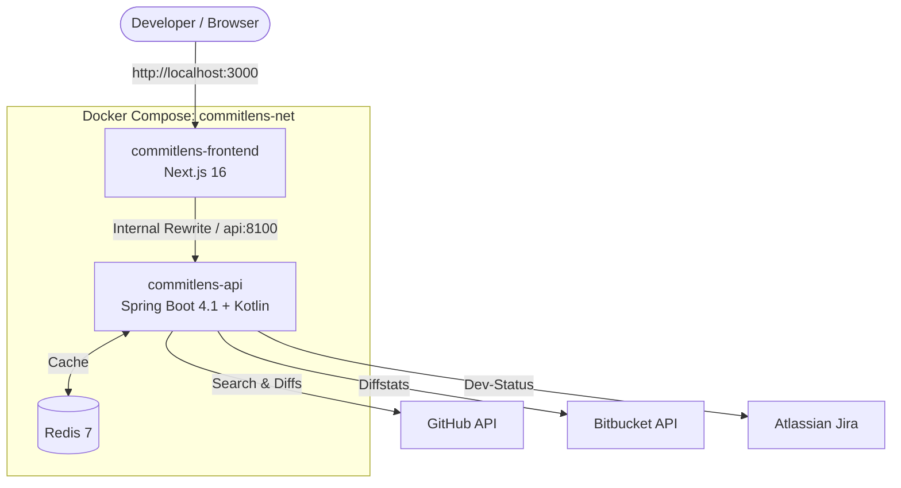

# CommitLens

CommitLens is a lightweight, self-hosted analytics engine that turns raw Git commit history from GitHub and Bitbucket into actionable insights. It parses every commit against the [Conventional Commits](https://www.conventionalcommits.org/) specification and traces Jira issues back to the code that implemented them — without requiring a database.



---

## Architecture & Tech Stack

| Layer    | Technology                                                                   |
|----------|------------------------------------------------------------------------------|
| Frontend | Next.js 16 (App Router, Standalone Build), Tailwind CSS, Recharts            |
| Backend  | Kotlin 2.3, Spring Boot 4.1, Spring Data Redis, Log4j2, springdoc-openapi    |
| Cache    | Redis 7+                                                                     |

```
commit-lens/
├── commitlens-api/        # Spring Boot + Kotlin REST API (port 8100)
├── commitlens-frontend/   # Next.js dashboard (port 3000)
├── docker-compose.yaml    # Redis + API + Frontend
└── .env.example           # Configuration template
```

The backend uses a provider strategy pattern (`GitProvider`, `SearchableGitProvider`, `RepositoryAwareGitProvider`), so each Git host advertises its own capabilities and new providers can be added without touching the service layer.

## Key Features

- **Conventional Commits parsing** — extracts `type`, `scope`, the `!` breaking-change marker and `BREAKING CHANGE:` footers, plus referenced Jira keys.
- **Jira issue-to-commit tracing** — resolves all commits linked to an issue via the Atlassian Dev-Status integration, across GitHub and Bitbucket repositories.
- **Repository analytics** — commit type distribution, compliance ratio, breaking-change counts and per-commit diff statistics.
- **Stateless & local-first** — no database; responses are cached in Redis and credentials never leave your machine.
- **Self-documenting API** — OpenAPI 3 spec with interactive Swagger UI.

## Quick Start (Docker Compose)

**Prerequisites:** Docker and Docker Compose v2.

```bash
git clone https://github.com/demirhany/commit-lens.git
cd commit-lens
cp .env.example .env      # then fill in the tokens you need
docker compose up -d
```

| Service    | URL                                     |
|------------|-----------------------------------------|
| Dashboard  | http://localhost:3000                   |
| Swagger UI | http://localhost:8100/swagger-ui.html   |
| OpenAPI    | http://localhost:8100/v3/api-docs       |

Stop the stack with `docker compose down` (add `-v` to also drop the Redis volume).

## Configuration

All configuration is provided through environment variables (see [`.env.example`](.env.example)). Only the variables for the integrations you use are required.

| Variable              | Required when             | Description |
|-----------------------|---------------------------|-------------|
| `GITHUB_TOKEN`        | Using GitHub              | Personal Access Token. **Classic PAT:** `repo` scope (or `public_repo` for public repositories only). **Fine-grained PAT:** read-only access to *Contents* and *Metadata*. |
| `BITBUCKET_TOKEN`     | Using Bitbucket           | Bitbucket access token with `repository:read` permission (workspace or repository access token). |
| `BITBUCKET_WORKSPACE` | Using Bitbucket           | Workspace slug, e.g. `my-team` from `bitbucket.org/my-team/`. |
| `JIRA_BASE_URL`       | Using Jira tracing        | Your Atlassian site, e.g. `https://your-company.atlassian.net`. |
| `JIRA_EMAIL`          | Using Jira tracing        | Email address of the Atlassian account that owns the API token. |
| `JIRA_TOKEN`          | Using Jira tracing        | API token from [id.atlassian.com/manage-profile/security/api-tokens](https://id.atlassian.com/manage-profile/security/api-tokens). The account needs *Browse Projects* permission and access to the development panel. |

Advanced (optional) variables:

| Variable                   | Default                  | Description |
|----------------------------|--------------------------|-------------|
| `SPRING_CACHE_TYPE`        | `redis`                  | Set to `none` to disable caching. |
| `SPRING_DATA_REDIS_HOST`   | `localhost`              | Redis host. |
| `SPRING_DATA_REDIS_PORT`   | `6379`                   | Redis port. |
| `APP_CORS_ALLOWED_ORIGINS` | `http://localhost:3000`  | Comma-separated list of allowed origins. |

> **Security:** never commit your `.env` file. Use tokens with the minimum read-only permissions required.

## Local Development

**Prerequisites:** JDK 21, Node.js 20+, and a running Redis instance (`docker compose up -d redis`).

### Backend

```bash
cd commitlens-api
export GITHUB_TOKEN=ghp_xxx   # plus any other variables you need
./mvnw spring-boot:run        # http://localhost:8100
./mvnw test                   # run the unit test suite
```

### Frontend

```bash
cd commitlens-frontend
npm install
npm run dev                   # http://localhost:3000
```

## Contributing

Issues and pull requests are welcome. Please use [Conventional Commits](https://www.conventionalcommits.org/) for your commit messages and make sure `./mvnw test` passes before opening a PR.

## License

Distributed under the [MIT License](LICENSE).